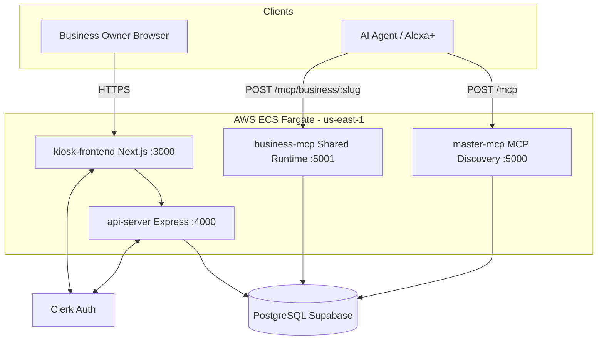
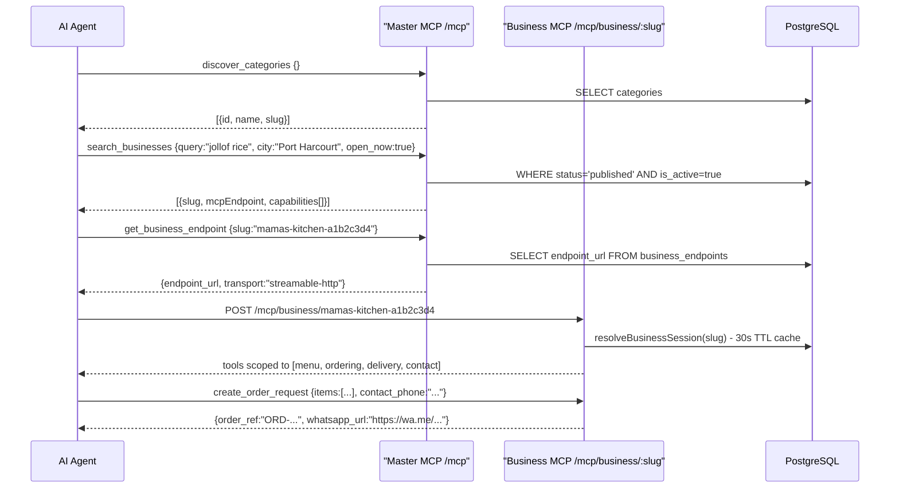

# Kiosk

> The discovery layer for the real-world business ecosystem.

A restaurant owner in Port Harcourt should not need to understand MCP, JSON-RPC, or cloud infrastructure to be discoverable by an AI agent. They fill in their business name, category, products, hours, and capabilities. Kiosk structures that information and provisions a business-specific MCP endpoint. An AI agent can discover that business, understand what it can do, and interact with it directly.

---

## How it works

```
Business Owner                     AI Agent (e.g. Alexa+)
      |                                    |
      | fills in normal                    | "find jollof rice
      | business info                      |  open now, delivers"
      |                                    |
      v                                    v
  Kiosk Frontend              Kiosk Master MCP  POST /mcp
      |                         (discovery-only, read-only)
      v                                    |
  API Server                    discover_categories
  POST /api/businesses           search_businesses
      |                          get_business_endpoint
      v                                    |
  PostgreSQL                               v
  (Supabase)              Business MCP  POST /mcp/business/:slug
                            (per-tenant, capability-scoped)
                                         |
                                         v
                              get_products / create_order_request
                              get_services / request_booking
                              get_contact  / get_delivery_information
```

---

## Architecture



### The fundamental distinction

Kiosk is **not** a centralised marketplace API. It is a discovery layer.

- **Master MCP** answers: *what businesses exist, what do they offer, where is their interface?*
- **Business MCP** answers: *here is what this specific business can actually do for you*

Each published business gets a tenant endpoint on a shared runtime:

```
POST https://mcp.kiosk.example/mcp                           <- Master MCP (discovery)
POST https://mcp.kiosk.example/mcp/business/mamas-kitchen    <- Business MCP (tenant)
POST https://mcp.kiosk.example/mcp/business/stylehouse-salon
POST https://mcp.kiosk.example/mcp/business/techfix-solutions
```

One process serves all business tenants. Business configuration is loaded from the database per request, with a 30-second TTL in-process cache.

---

## MCP Implementation

| | Detail |
|---|---|
| SDK | `@modelcontextprotocol/sdk@1.32.0` |
| Protocol version | `2025-11-25` (SDK `LATEST_PROTOCOL_VERSION`) |
| Transport | Streamable HTTP (`StreamableHTTPServerTransport`) |
| Master MCP endpoint | `POST /mcp` (port 5000) |
| Business MCP endpoint | `POST /mcp/business/:slug` (port 5001) |

### Master MCP - 10 discovery tools

All tools query `status = 'published' AND is_active = true` at the SQL layer. `ownerClerkId` is never selected.

| Tool | Purpose |
|---|---|
| `discover_categories` | List all business categories |
| `search_businesses` | Search by query, city, category, open_now |
| `get_business` | Full public profile by slug |
| `get_business_capabilities` | Which tools are available on the Business MCP |
| `get_business_endpoint` | Returns DB-stored external URL or computed hosted URL |
| `get_business_services` | Available services for service businesses |
| `get_business_products` | Available products (optional category filter) |
| `check_business_status` | Open/closed with timezone-aware calculation |
| `get_business_contact` | Phone, WhatsApp URL, website - no private data |
| `get_business_delivery` | Delivery capability config |

### Business MCP - capability-gated tools

The tool list is built dynamically per session from the business's enabled capabilities:

```
Always present (5 base tools):
  get_business_info  get_services  get_hours  get_contact  get_capabilities

Gated by capability:
  get_products             <- requires capability: products
  get_delivery_information <- requires capability: delivery
  create_order_request     <- requires capability: ordering
  request_booking          <- requires capability: booking
```

A business without `ordering` never exposes `create_order_request`. This is enforced in `buildToolList()` before any tool is registered on the `McpServer` instance.

### Discovery flow (agent perspective)



---

## Quick start

**Prerequisites:** Node.js 20+, pnpm, a Supabase PostgreSQL database, Clerk credentials

```bash
# 1. Clone and install
git clone <repo>
pnpm install

# 2. Environment
cp .env.example .env
# Set: DATABASE_URL, CLERK_SECRET_KEY, CLERK_PUBLISHABLE_KEY,
#      NEXT_PUBLIC_CLERK_PUBLISHABLE_KEY, NEXT_PUBLIC_API_URL=http://localhost:4000

# 3. Database
pnpm --filter @workspace/db push    # applies schema to Supabase
pnpm --filter @workspace/db seed    # inserts categories + 3 demo businesses

# 4. Start services (4 terminals)
pnpm --filter @workspace/api-server dev       # http://localhost:4000
pnpm --filter @workspace/master-mcp start    # http://localhost:5000/mcp
pnpm --filter @workspace/business-mcp start  # http://localhost:5001/mcp/business/:slug
pnpm --filter @workspace/kiosk-frontend dev  # http://localhost:3000
```

Or with Docker Compose:

```bash
cp .env.example .env   # fill in DATABASE_URL + Clerk keys
docker compose up --build
```

---

## Demo businesses (seeded)

| Business | Slug | Category | Capabilities |
|---|---|---|---|
| Mama's Kitchen | `mamas-kitchen-*` | Restaurant | menu, ordering, delivery, contact |
| StyleHouse Salon | `stylehouse-salon-*` | Salon & Beauty | services, booking, contact |
| TechFix Solutions | `techfix-solutions-*` | Electronics & Repairs | services, contact, information |

---

## Environment variables

| Variable | Required | Description |
|---|---|---|
| `DATABASE_URL` | Yes | PostgreSQL connection string |
| `CLERK_SECRET_KEY` | Yes | Clerk server-side key |
| `CLERK_PUBLISHABLE_KEY` | Yes | Clerk publishable key (api-server) |
| `NEXT_PUBLIC_CLERK_PUBLISHABLE_KEY` | Yes | Clerk publishable key (frontend) |
| `NEXT_PUBLIC_API_URL` | Yes | API server URL (default: http://localhost:4000) |

---

## Testing

```bash
# Type-check entire monorepo
pnpm typecheck

# Property-based tests (fast-check) - 26 tests across 4 packages
pnpm --filter @workspace/db test           # slug format, isBusinessOpen boundaries
pnpm --filter @workspace/api-server test   # owner isolation
pnpm --filter @workspace/master-mcp test   # discovery isolation
pnpm --filter @workspace/business-mcp test # capability exposure, MCP privacy

# E2E agent flow (requires all 4 services running)
pnpm e2e
# Exercises: Master MCP discover -> search -> endpoint -> Business MCP -> order_request
```

---

## AWS infrastructure

Production runs on ECS Fargate in `us-east-1`. All four services run as Fargate tasks behind an ALB with host-based and path-based routing.

| Host | Path | Service | vCPU | RAM |
|---|---|---|---|---|
| `kiosk.example` | `/*` | kiosk-frontend | 0.5 | 1 GB |
| `api.kiosk.example` | `/*` | api-server | 0.5 | 1 GB |
| `mcp.kiosk.example` | `/mcp` | master-mcp | 0.5 | 1 GB |
| `mcp.kiosk.example` | `/mcp/business/*` | business-mcp | 1.0 | 2 GB |

All secrets are in AWS Secrets Manager - injected into ECS tasks by ARN, never as plaintext. Detailed topology: [docs/aws.md](docs/aws.md).

---

## CI/CD

GitHub Actions pipeline: **install -> typecheck + test + format -> build -> mcp-health -> docker push + ECS deploy**

The `docker` job runs only on `main` pushes. It builds all 4 images, pushes to ECR, and triggers rolling ECS deployments.

---

## Documentation

| File | Content |
|---|---|
| [docs/architecture.md](docs/architecture.md) | Full system architecture with diagrams |
| [docs/mcp.md](docs/mcp.md) | MCP protocol, tool schemas, discovery flow |
| [docs/business-runtime.md](docs/business-runtime.md) | Multi-tenant shared runtime design |
| [docs/aws.md](docs/aws.md) | AWS infrastructure and deployment |
| [docs/security.md](docs/security.md) | Auth, owner isolation, privacy model |
| [docs/testing.md](docs/testing.md) | Testing guide and property inventory |
| [docs/demo.md](docs/demo.md) | Demo walkthrough and recording guide |

---

## Hackathon

Built for the **Build, Ship, Shape: Amazon Developer Hackathon 2026**.

- **Primary track:** Alexa+
- **Mini-challenge:** AWS Builder

The Alexa+ track requires a self-hosted MCP server using MCP specification **2025-11-25** minimum over **Streamable HTTP**. Both MCP servers use `StreamableHTTPServerTransport` from the official SDK, which negotiates `2025-11-25` as its `LATEST_PROTOCOL_VERSION`.

---

## Vision

The internet was built for people browsing websites.

The next interface is increasingly being built for agents.

Kiosk is the map between those two worlds — real businesses, structured capabilities, AI agents.