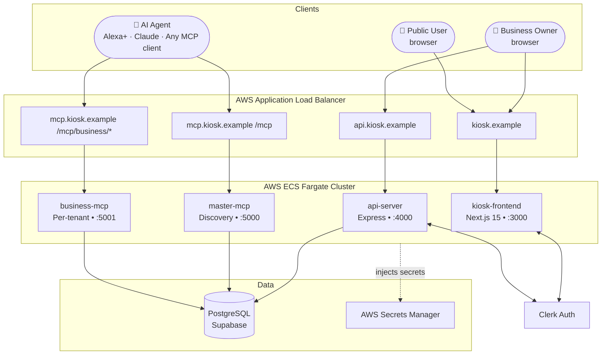
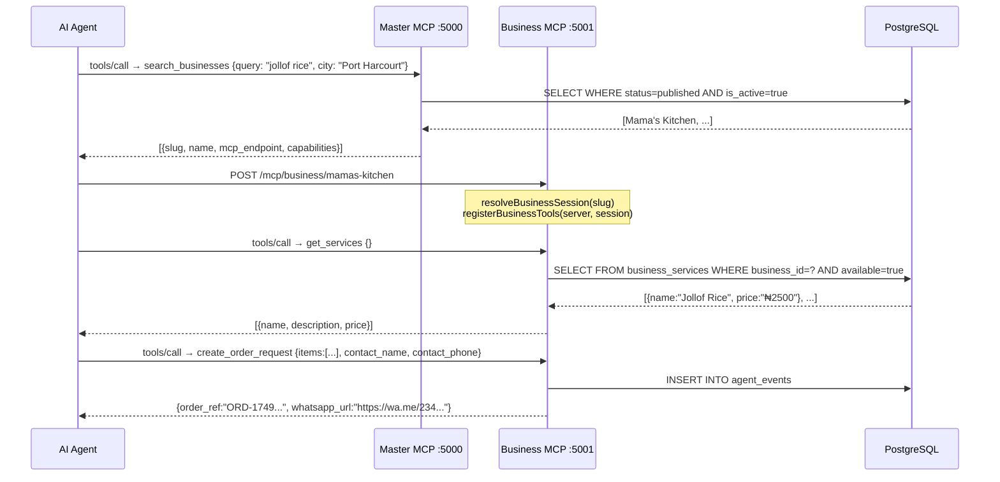
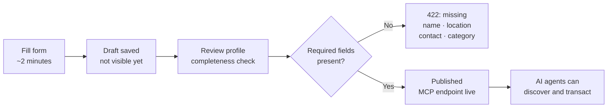
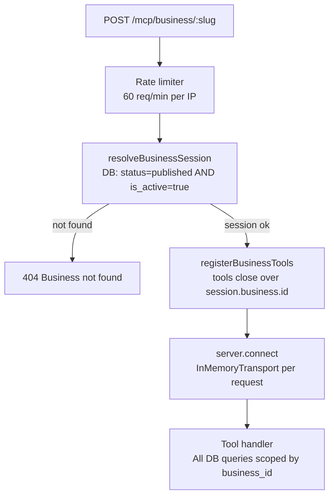
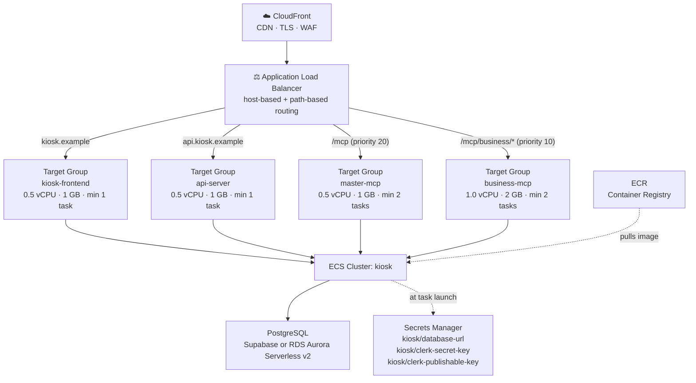
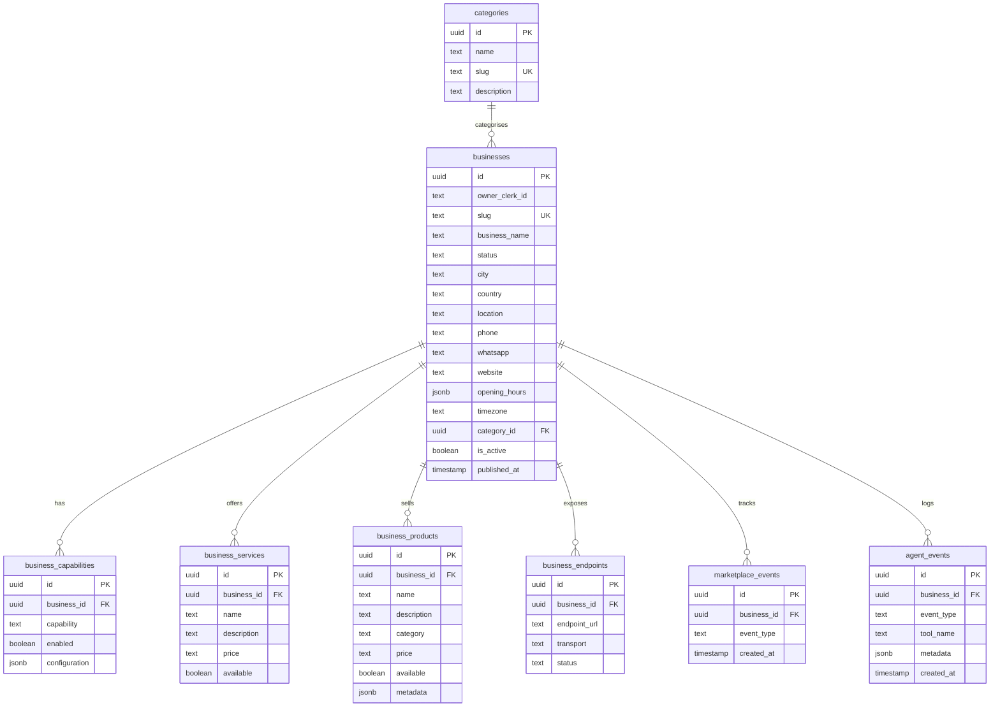

<div align="center">

# Kiosk — Agent Commerce Infrastructure

**Turn any local business into an AI-agent-readable storefront in under two minutes.**

Kiosk provisions a live [Model Context Protocol](https://modelcontextprotocol.io) endpoint for every business that signs up. AI agents — Amazon Alexa+, Claude, GPT, or any MCP-compatible client — can discover, query, and transact with real local businesses without a custom integration per business.

[](https://www.typescriptlang.org/)
[](https://nextjs.org/)
[](https://modelcontextprotocol.io)
[](https://aws.amazon.com/ecs/)
[](#running-tests)

</div>

---

## Table of Contents

- [What Kiosk Does](#what-kiosk-does)
- [System Architecture](#system-architecture)
- [AWS Infrastructure](#aws-infrastructure)
- [Monorepo Structure](#monorepo-structure)
- [Quick Start for Judges](#quick-start-for-judges)
- [Environment Variables](#environment-variables)
- [Running the Services](#running-the-services)
- [Running Tests](#running-tests)
- [MCP Endpoints Reference](#mcp-endpoints-reference)
- [Demo Script](#demo-script)
- [Data Model](#data-model)
- [Key Engineering Decisions](#key-engineering-decisions)
- [Known Limitations and Future Work](#known-limitations-and-future-work)

---

## What Kiosk Does

Local businesses are invisible to AI agents today. There is no standard way for an agent to ask "what hair salons are open near me right now and can I book one?" and get a structured, actionable answer.

Kiosk solves this at the infrastructure layer:

1. **A business owner fills in a two-minute form** — name, description, category, hours, contact. No code required.
2. **Kiosk provisions a live MCP endpoint** at `POST /mcp/business/:slug`. The endpoint exposes structured, read-only tools: `get_business_info`, `get_services`, `get_hours`, `get_contact`, `get_capabilities`, and optionally `request_booking`, `create_order_request`, `get_products`, and more.
3. **AI agents discover businesses** through the Master MCP at `/mcp` using `search_businesses` and `discover_categories`, then connect directly to each business's own endpoint to transact.

---

## System Architecture

### High-Level Overview



### Agent Discovery Sequence



### Business Onboarding Flow



### Tenant Isolation in Business MCP



---

## AWS Integrations

Kiosk uses six AWS services. The full integration guide is at [`docs/aws-integrations.md`](docs/aws-integrations.md).

| AWS Service | How Kiosk uses it |
|---|---|
| **ECS Fargate** | Runs all 4 services — chosen over Lambda because MCP uses Server-Sent Events which need persistent connections |
| **AgentCore** | Kiosk is an MCP tool provider for AgentCore — agents configured with Kiosk's Master MCP can discover and transact with businesses automatically |
| **Bedrock (Titan Embeddings v2)** | Semantic vector scoring in `search_businesses` — "something for my hair" finds hair salons without keyword matching |
| **Strands SDK** | Documented as the recommended Python agent client for developers building on top of Kiosk |
| **Secrets Manager** | All credentials injected into ECS tasks by ARN — no plaintext secrets in task definitions or logs |
| **CloudWatch Logs** | Structured pino JSON logs from all services, with request ID correlation across log lines |

---

## AWS Infrastructure

### Why ECS Fargate, not Lambda

MCP uses **Streamable HTTP with Server-Sent Events**. Lambda's 15-minute maximum execution time and cold-start behaviour conflict with persistent SSE connections. ECS Fargate gives always-warm containers with no execution time limit.

### Infrastructure Topology



### ALB Routing Rules

| Priority | Host | Path | Target Service |
|---|---|---|---|
| 10 | `mcp.kiosk.example` | `/mcp/business/*` | business-mcp :5001 |
| 20 | `mcp.kiosk.example` | `/mcp`, `/mcp/sse` | master-mcp :5000 |
| 30 | `api.kiosk.example` | `/*` | api-server :4000 |
| 40 | `kiosk.example` | `/*` | kiosk-frontend :3000 |

> The business-mcp rule (priority 10) must be registered before master-mcp (priority 20) so `/mcp/business/*` routes correctly.

### Service Sizing and Auto-Scaling

| Service | vCPU | RAM | Min | Max | Scale target |
|---|---|---|---|---|---|
| kiosk-frontend | 0.5 | 1 GB | 1 | 5 | 60% CPU |
| api-server | 0.5 | 1 GB | 1 | 5 | 60% CPU |
| master-mcp | 0.5 | 1 GB | 2 | 10 | 60% CPU |
| business-mcp | 1.0 | 2 GB | 2 | 20 | 60% CPU |

Business-mcp gets more resources because it handles all tenant sessions concurrently in a single shared runtime.

### Deployment

```bash
# Authenticate with ECR
aws ecr get-login-password --region us-east-1 \
  | docker login --username AWS --password-stdin \
    $AWS_ACCOUNT_ID.dkr.ecr.us-east-1.amazonaws.com

# Build and push all images
for svc in api-server business-mcp master-mcp kiosk-frontend; do
  docker build -t kiosk-$svc ./artifacts/$svc
  docker tag kiosk-$svc:latest \
    $AWS_ACCOUNT_ID.dkr.ecr.us-east-1.amazonaws.com/kiosk-$svc:latest
  docker push \
    $AWS_ACCOUNT_ID.dkr.ecr.us-east-1.amazonaws.com/kiosk-$svc:latest
done

# Register task definitions and rolling deploy (zero downtime)
for svc in api-server business-mcp master-mcp kiosk-frontend; do
  aws ecs register-task-definition \
    --cli-input-json file://docs/aws/task-definitions/$svc.json
  aws ecs update-service \
    --cluster kiosk --service kiosk-$svc --force-new-deployment
done
```

Task definitions: [`docs/aws/task-definitions/`](docs/aws/task-definitions/)

---

## Monorepo Structure

```
kiosk-agent-commerce/
├── artifacts/
│   ├── kiosk-frontend/        Next.js 15 — business owner UI + public marketplace
│   │   └── src/
│   │       ├── App.tsx        Landing page, Create Kiosk page
│   │       ├── Surfaces.tsx   Dashboard, Marketplace, Business detail, Auth
│   │       └── components/    Footer, ThemeToggle, SettingsPage, Spinner
│   ├── api-server/            Express REST API
│   │   └── src/
│   │       ├── routes/        businesses, marketplace, categories, capabilities, services
│   │       ├── middlewares/   requireAuth, errorHandler, rateLimiter
│   │       └── lib/           ownership, publishReadiness, mcp-url, logger
│   ├── master-mcp/            Discovery MCP server (port 5000)
│   │   └── src/
│   │       └── tools/         discovery, profile, utility tools (10 total)
│   └── business-mcp/          Shared per-tenant MCP runtime (port 5001)
│       └── src/
│           ├── tools/         base.ts, optional.ts, register.ts, index.ts
│           ├── lib/           rateLimiter, recordEvent
│           └── __tests__/     integration.test.ts, tools.test.ts, privacy.test.ts
├── lib/
│   ├── db/                    Drizzle ORM — schema, migrations, seed, utilities
│   │   └── src/
│   │       ├── schema/        businesses, categories, capabilities, services, products,
│   │       │                  marketplace-events, agent-events, endpoints
│   │       ├── lib/           slug.ts, hours.ts
│   │       └── seed/          categories, businesses (3 demo businesses)
│   ├── api-zod/               Shared Zod validation schemas
│   │   └── src/schemas.ts     CreateBusinessBodyV2, UpdateBusinessBodyV2,
│   │                          phone/website/whatsapp validation, OpeningHoursSchema
│   └── api-client-react/      React Query hooks (orval-generated + custom)
├── docs/
│   ├── architecture.md        Full architecture reference
│   ├── mcp.md                 All MCP tool schemas with input/output examples
│   ├── business-runtime.md    Business MCP runtime design
│   ├── security.md            Auth, ownership, private-data policy, rate limiting
│   ├── testing.md             Test strategy, property inventory
│   ├── demo.md                Hackathon demo script
│   └── aws/                   ECS task definitions, ALB rules, auto-scaling config
├── scripts/
│   └── e2e-agent-flow.ts      End-to-end agent discovery test script
├── .env.example               All required environment variables documented
├── pnpm-workspace.yaml        Workspace packages + catalog
└── README.md                  This file
```

---

## Quick Start for Judges

### Prerequisites

- **Node.js** ≥ 18 — [nodejs.org](https://nodejs.org)
- **pnpm** — `npm install -g pnpm`
- **PostgreSQL** — [Supabase free tier](https://supabase.com) works perfectly
- **Clerk account** — [clerk.com](https://clerk.com) (free tier, takes 2 minutes)

### Step 1 — Clone and install

```bash
git clone <repo-url> kiosk-agent-commerce
cd kiosk-agent-commerce
pnpm install
```

### Step 2 — Environment variables

```bash
cp .env.example .env
```

Open `.env` and fill in these four values (everything else has a working default):

```
DATABASE_URL=postgresql://...          # from Supabase: Settings > Database > Connection string
CLERK_SECRET_KEY=sk_test_...           # from Clerk: API Keys
CLERK_PUBLISHABLE_KEY=pk_test_...      # from Clerk: API Keys
NEXT_PUBLIC_CLERK_PUBLISHABLE_KEY=pk_test_...   # same value as above
```

### Step 3 — Database setup

```bash
cd lib/db

# Push the full schema to your database
npx drizzle-kit push

# Seed 10 business categories + 3 demo businesses
npx tsx src/seed/index.ts
```

### Step 4 — Start all services

Open four separate terminals:

```bash
# Terminal 1 — API server (REST API, port 4000)
cd artifacts/api-server
pnpm build && pnpm start

# Terminal 2 — Business MCP (per-tenant MCP runtime, port 5001)
cd artifacts/business-mcp
pnpm build && pnpm start

# Terminal 3 — Master MCP (discovery, port 5000)  [optional for basic demo]
cd artifacts/master-mcp
pnpm build && pnpm start

# Terminal 4 — Frontend (Next.js, port 3000)
cd artifacts/kiosk-frontend
pnpm dev
```

### Step 5 — Open the app

Go to [http://localhost:3000](http://localhost:3000)

### Step 6 — Verify MCP is working

```bash
# List all available tools on a demo business endpoint
curl -s -X POST http://localhost:5001/mcp/business/stylehouse-salon-PORT-HERE \
  -H "Content-Type: application/json" \
  -d '{"jsonrpc":"2.0","id":1,"method":"tools/list","params":{}}' \
  | jq '.result.tools[].name'

# Expected output:
# "get_business_info"
# "get_services"
# "get_hours"
# "get_contact"
# "get_capabilities"
# "request_booking"    ← only if booking capability enabled
```

> Replace `stylehouse-salon-PORT-HERE` with the actual slug from your seeded demo data (check your database or the dashboard after logging in).

---

## Environment Variables

Full reference — all variables are documented in `.env.example`.

| Variable | Service | Required | Description |
|---|---|---|---|
| `DATABASE_URL` | api-server, both MCPs | Yes | PostgreSQL connection string |
| `CLERK_SECRET_KEY` | api-server | Yes | Clerk server-side secret key |
| `CLERK_PUBLISHABLE_KEY` | api-server | Yes | Clerk publishable key |
| `NEXT_PUBLIC_CLERK_PUBLISHABLE_KEY` | frontend | Yes | Clerk publishable key (browser) |
| `NEXT_PUBLIC_API_URL` | frontend | Yes | API server URL (default `http://localhost:4000`) |
| `MCP_BASE_URL` | api-server | No | MCP server base URL (default `http://localhost:5001`) |
| `NEXT_PUBLIC_MCP_BASE_URL` | frontend | No | MCP base URL for browser display (same default) |
| `PORT` | api-server | No | API server port (default `4000`) |
| `MCP_PORT` | business-mcp | No | Business MCP port (default `5001`) |
| `LOG_LEVEL` | all servers | No | Pino log level — `info` default, `debug` for dev |
| `NODE_ENV` | all servers | No | `development` enables pino-pretty logs |

In production (ECS), all secrets are injected from **AWS Secrets Manager** ARNs — no plaintext values in task definitions.

---

## Running the Services

### Development mode

```bash
# API server — hot reloads on save
cd artifacts/api-server && pnpm dev

# Frontend — Next.js dev server with HMR
cd artifacts/kiosk-frontend && pnpm dev
```

### Production build and start

```bash
# Each service independently
cd artifacts/api-server     && pnpm build && pnpm start
cd artifacts/business-mcp   && pnpm build && pnpm start
cd artifacts/master-mcp     && pnpm build && pnpm start
cd artifacts/kiosk-frontend && pnpm build && pnpm start
```

---

## Running Tests

### All test suites

```bash
# lib/db — slug generation + opening hours utilities (12 tests)
cd lib/db && npx vitest run

# api-server — ownership isolation + publish readiness (16 tests)
cd artifacts/api-server && npx vitest run

# business-mcp — tool registration, privacy, integration via InMemoryTransport (21 tests)
cd artifacts/business-mcp && npx vitest run
```

### Typecheck all packages

```bash
cd lib/api-zod              && npx tsc --noEmit
cd artifacts/api-server     && npx tsc --noEmit
cd artifacts/business-mcp   && npx tsc --noEmit
cd artifacts/kiosk-frontend && npx tsc --noEmit
```

### Test inventory

| Package | Suite | Count | What it proves |
|---|---|---|---|
| `lib/db` | `slug.test.ts` | 5 | Slug format invariant, uniqueness across UUIDs |
| `lib/db` | `hours.test.ts` | 7 | Open/closed boundary correctness, timezone handling |
| `api-server` | `ownership.test.ts` | 3 | Owner isolation — cross-tenant access always returns nothing |
| `api-server` | `publishReadiness.test.ts` | 13 | All blocking/recommended field combinations |
| `business-mcp` | `tools.test.ts` | 5 | Capability-aware tool list — property-based with fast-check |
| `business-mcp` | `privacy.test.ts` | 2 | `ownerClerkId` never leaks into MCP responses |
| `business-mcp` | `integration.test.ts` | 14 | Real connected server+client via `InMemoryTransport` — tools/list, get_contact field mapping, website-in-phone regression, tenant isolation |
| **Total** | | **49** | |

---

## MCP Endpoints Reference

### Business MCP — `POST /mcp/business/:slug`

Every published business gets a unique endpoint. Tools are registered at request time based on the business's enabled capabilities.

**Always available (5 base tools):**

| Tool | Description |
|---|---|
| `get_business_info` | Full public profile: name, description, city, country, hours, timezone |
| `get_services` | All available services with names, descriptions, prices |
| `get_hours` | Opening hours per day of week + timezone |
| `get_contact` | Phone, WhatsApp URL (`https://wa.me/...`), website. Never exposes owner email. |
| `get_capabilities` | List of enabled MCP capabilities for this business |

**Optional (enabled per business capability):**

| Tool | Required capability | Description |
|---|---|---|
| `get_products` | `products` | Available products with category and price |
| `get_delivery_information` | `delivery` | Delivery areas, estimated time, fees |
| `create_order_request` | `ordering` | Records order intent, returns `order_ref` + WhatsApp URL |
| `request_booking` | `booking` | Records booking request, returns `booking_ref` |

### Example tool call

```bash
curl -X POST http://localhost:5001/mcp/business/mamas-kitchen-abc123 \
  -H "Content-Type: application/json" \
  -d '{
    "jsonrpc": "2.0",
    "id": 1,
    "method": "tools/call",
    "params": {
      "name": "get_contact",
      "arguments": {}
    }
  }'
```

```json
{
  "result": {
    "content": [{
      "type": "text",
      "text": "{\"phone\":\"+2348012345678\",\"whatsapp\":\"2348012345678\",\"whatsapp_url\":\"https://wa.me/2348012345678\",\"website\":\"https://mamaskitchen.ng\"}"
    }]
  }
}
```

### Master MCP — `POST /mcp`

Discovery tools for AI agents to find businesses across the platform. All queries filter `status = 'published' AND is_active = true` at the SQL layer.

| Tool | Description |
|---|---|
| `search_businesses` | Full-text search with city, category, open_now filters |
| `discover_categories` | List all 10 business categories |
| `get_business` | Full public profile by slug |
| `get_business_capabilities` | Capabilities list by slug |
| `get_business_endpoint` | Returns the MCP endpoint URL for a business |
| `get_business_services` | Services for a business by slug |
| `get_business_products` | Products for a business by slug |
| `check_business_status` | Is the business open right now? (timezone-aware) |
| `get_business_contact` | Contact info by slug |
| `get_business_delivery` | Delivery configuration by slug |

---

## Demo Script

A complete judge walkthrough is in [`docs/demo.md`](docs/demo.md). Quick version:

### 1. Sign up as a business owner

Go to [http://localhost:3000](http://localhost:3000) → **Create your Kiosk** → fill the form → publish.

### 2. See your MCP endpoint appear

On the dashboard, click **Publish Kiosk**. The panel shows:

```
AI-readable business presence — ACTIVE
http://localhost:5001/mcp/business/your-business-name-abc123
```

Copy that URL.

### 3. Query it as an AI agent

```bash
# See all tools
curl -X POST <your-mcp-url> \
  -H "Content-Type: application/json" \
  -d '{"jsonrpc":"2.0","id":1,"method":"tools/list","params":{}}'

# Get business info
curl -X POST <your-mcp-url> \
  -H "Content-Type: application/json" \
  -d '{"jsonrpc":"2.0","id":1,"method":"tools/call","params":{"name":"get_business_info","arguments":{}}}'
```

### 4. Browse the demo businesses

Go to [http://localhost:3000/marketplace](http://localhost:3000/marketplace) to see the seeded demo businesses (Mama's Kitchen, StyleHouse Salon, TechFix Solutions).

---

## Data Model



---

## Key Engineering Decisions

**MCP Streamable HTTP over Lambda** — MCP's Server-Sent Events transport requires persistent connections. ECS Fargate containers are always warm; Lambda's 15-minute limit and cold starts would break SSE.

**Shared Business MCP runtime** — One `business-mcp` process handles all tenants via slug routing. Each request resolves the session, registers tools that close over `session.business.id`, and discards the server after the response. No per-tenant processes. A 30-second in-memory TTL cache reduces DB round-trips.

**Publish readiness gate** — The `PATCH /businesses/:id/publish` endpoint runs `checkPublishReadiness()` before allowing a publish. This returns a `422` with a structured `blocking` array if required fields (name, location, contact, category) are missing. The frontend shows a completeness progress bar using the same logic.

**Validation at the schema layer** — Phone, website, and WhatsApp validation lives in `lib/api-zod/src/schemas.ts` — one place, inherited by both `CreateBusinessBodyV2` and `UpdateBusinessBodyV2`. WhatsApp values are normalised to digits-only at write time so `get_contact` always returns a clean `wa.me` URL.

**Tenant isolation by session closure** — Every tool handler closes over its `session.business.id`. All database queries inside tool handlers use that ID as a filter. Tests use `InMemoryTransport` to create real connected server/client pairs and verify that two tenant servers return only their own data.

**Rate limiting without new dependencies** — An in-process token-bucket limiter covers public MCP (60 req/min) and write API endpoints (30 req/min) with no external package. Swap to Redis-backed `express-rate-limit` before multi-instance production.

---

## Known Limitations and Future Work

| Area | Current state | Production path |
|---|---|---|
| Rate limiting | In-process, per-instance | Redis-backed `express-rate-limit` for multi-instance |
| Session cache | In-memory Map, 30s TTL | Redis with distributed invalidation |
| Clerk user deletion | No webhook — orphaned business records possible | Add `user.deleted` Clerk webhook |
| HTTPS enforcement | TLS at load balancer only | Add HSTS headers at app layer |
| Master MCP auth | Unauthenticated discovery | API key or Clerk JWT for private catalogues |
| Catalogue (products/images) | Data model ready, UI not exposed | Phase 2 feature |
| Dark mode | Removed — surfaces use hardcoded colour tokens | Refactor surfaces to CSS variable tokens |

---

<div align="center">

Built for the AWS Hackathon · Kiosk Technologies Ltd · 2025

</div>
