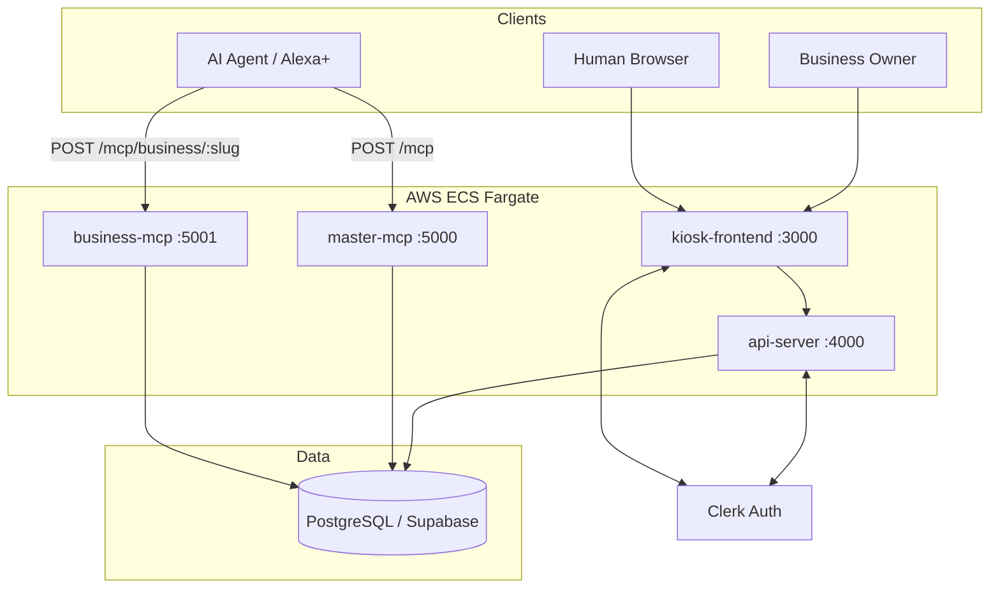
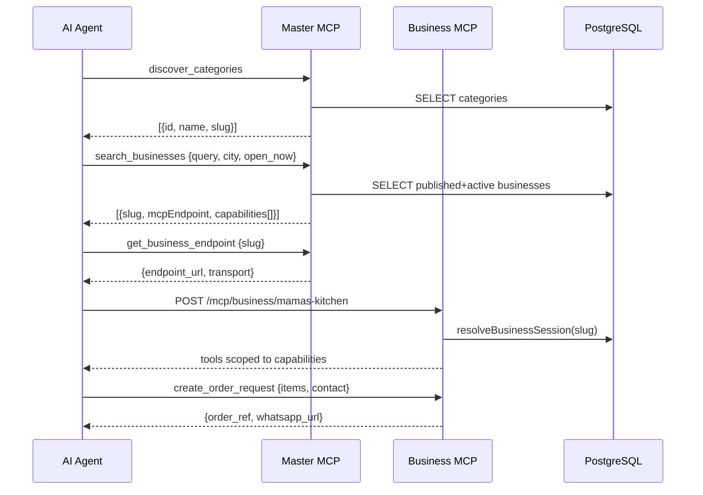
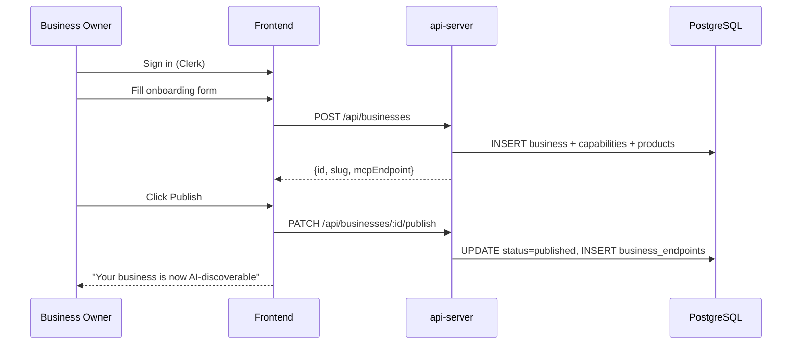

# Kiosk System Architecture

## What is Kiosk?

Kiosk is an AI-facing discovery infrastructure for the real-world business ecosystem. Business owners register their business in plain language; Kiosk structures that data and provisions a business-specific MCP endpoint. AI agents use the Master MCP to discover businesses, then interact with each business via its own MCP interface.

## The Fundamental Distinction

**Kiosk is NOT a centralised marketplace API.**

```
Kiosk    = the discovery layer  (the market)
Business MCP = each business's own AI interface  (the individual shop door)
```

An AI agent enters through the market (Master MCP), finds the right shop (discovery), then walks through the shop door (Business MCP) to interact with that specific business.

## Architecture Diagram



## Components

| Component | Path | Port | Purpose |
|-----------|------|------|---------|
| kiosk-frontend | artifacts/kiosk-frontend | 3000 | Business owner UI + public marketplace |
| api-server | artifacts/api-server | 4000 | Authenticated REST API (CRUD + discovery) |
| master-mcp | artifacts/master-mcp | 5000 | AI-facing discovery MCP (read-only, 10 tools) |
| business-mcp | artifacts/business-mcp | 5001 | Shared business MCP runtime (tenant-routed) |
| lib/db | lib/db |   | Drizzle ORM, schema, migrations, seed |
| lib/api-zod | lib/api-zod |   | Zod validation schemas |
| lib/api-client-react | lib/api-client-react |   | React Query hooks |

## Request Flow AI Agent Discovery



## Request Flow Business Owner Onboarding



## Multi-Tenant Business MCP

All business tenants share one `business-mcp` process. Routing happens by slug:

```
POST /mcp/business/mamas-kitchen     ? Mama's Kitchen session
POST /mcp/business/stylehouse-salon  ? StyleHouse Salon session
POST /mcp/business/techfix-solutions ? TechFix Solutions session
```

Each request: resolves business from DB (with 30s TTL cache) ? builds session-scoped tool list based on enabled capabilities ? handles MCP request ? records analytics event.

## External MCP Support

A business with its own MCP server can register its endpoint URL via the dashboard. Kiosk stores it in `business_endpoints` and `get_business_endpoint` returns the external URL instead of the hosted Kiosk URL. The business retains full ownership of its own MCP interface.