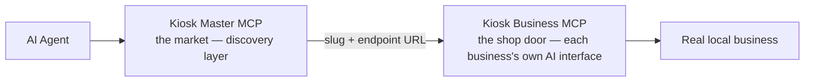
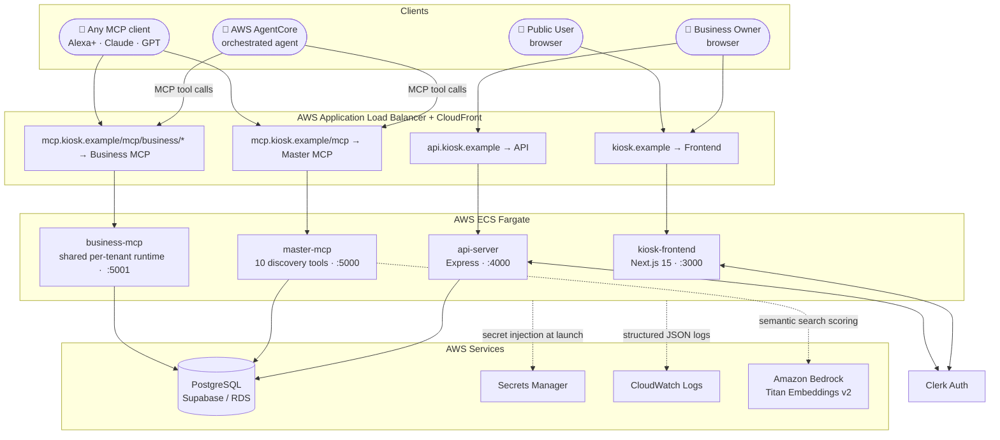
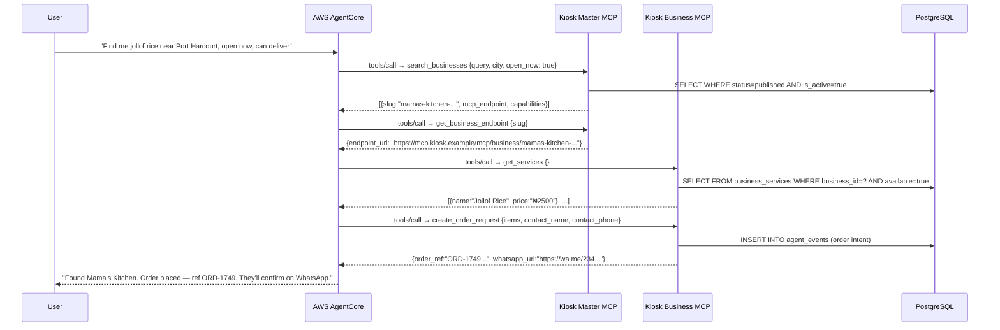
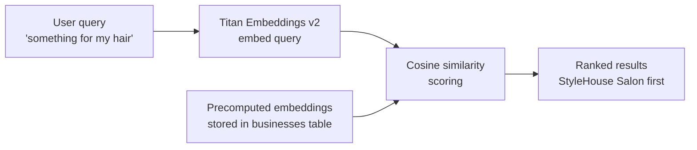
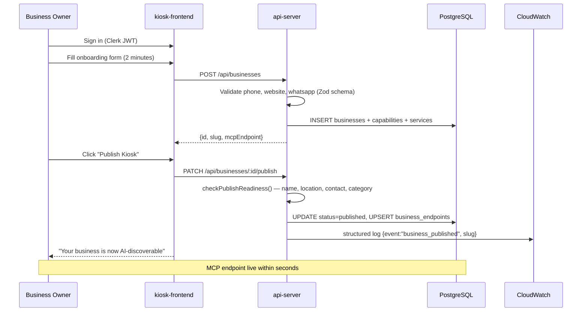
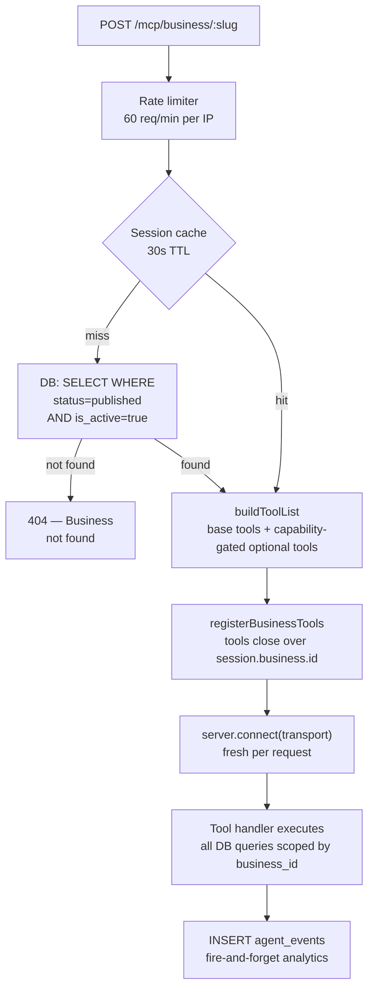
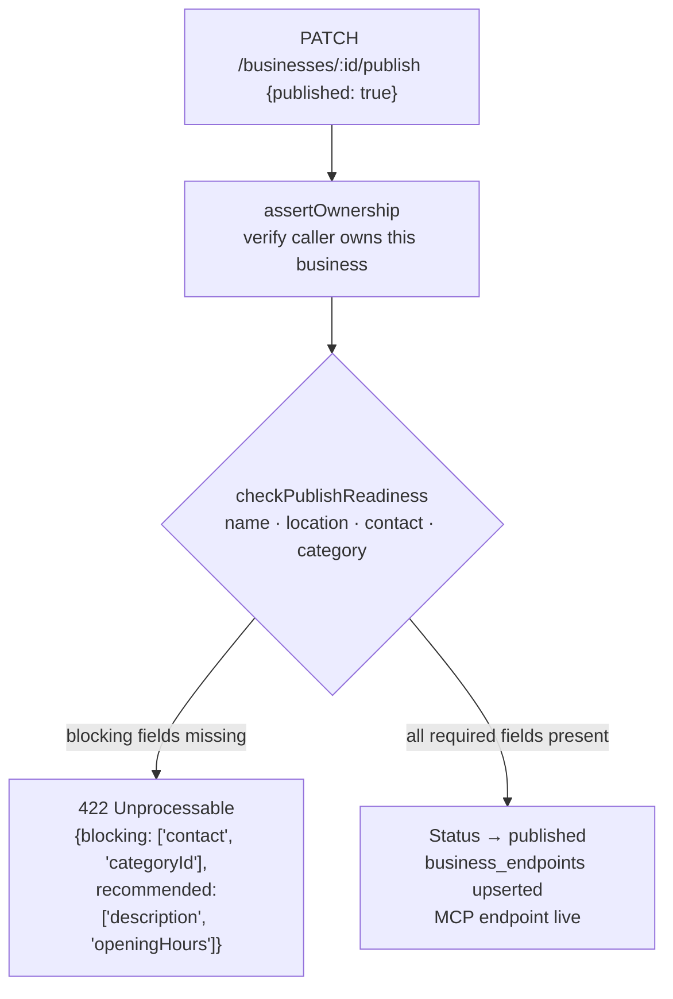
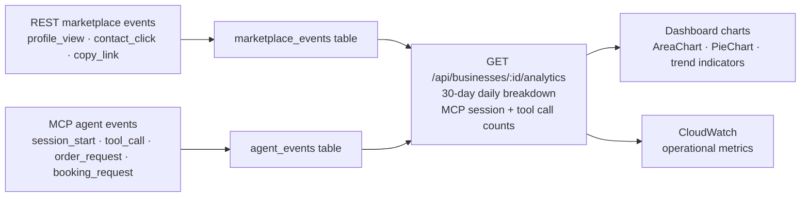

# Kiosk — System Architecture

## What Kiosk Is

Kiosk is the **MCP infrastructure layer for local commerce**. Business owners register their business in plain language — no code, no technical knowledge. Kiosk structures that data and provisions a live MCP endpoint for every business. AI agents built on AWS AgentCore, Amazon Alexa+, or any MCP-compatible runtime can then discover, query, and transact with those businesses through a standard protocol interface.

---

## The Core Distinction

**Kiosk is not a centralised API.** It is an infrastructure layer that gives every business its own AI interface.



An agent enters through the market, finds the right shop, then walks through the shop door to interact with that specific business. The market and the door are separate services with separate responsibilities.

---

## High-Level Architecture



---

## AWS AgentCore Integration

AWS AgentCore is Amazon's managed runtime for orchestrating AI agents. Kiosk's MCP servers are designed to be **first-class AgentCore tool providers**.



### AgentCore Configuration

AgentCore discovers Kiosk's tools via the Master MCP endpoint. No custom adapter is needed — AgentCore speaks MCP natively.

```json
{
  "agentName": "KioskCommerceAgent",
  "mcpServers": [
    {
      "name": "kiosk-master",
      "endpoint": "https://mcp.kiosk.example/mcp",
      "transport": "streamable-http"
    }
  ],
  "instructions": "You help users find and transact with local businesses. Use search_businesses to discover options, then connect to the business MCP endpoint for transactions."
}
```

Full AgentCore integration guide: [`docs/aws-integrations.md`](aws-integrations.md)

---

## Amazon Bedrock Integration

Kiosk uses **Amazon Bedrock Titan Embeddings v2** to power semantic search in the Master MCP's `search_businesses` tool. Keyword search alone fails when a user asks for "something for my hair" — semantic scoring bridges natural language to structured business data.



When Bedrock is not available (local dev), Kiosk falls back to `pg_trgm` trigram similarity — no code path breaks.

Full Bedrock integration guide: [`docs/aws-integrations.md`](aws-integrations.md)

---

## Request Flow — Business Owner Onboarding



---

## Multi-Tenant Business MCP Runtime

All business tenants share one `business-mcp` process. This is a deliberate design decision — one process per business would not scale.



---

## Publish Readiness Gate



---

## Components Reference

| Component | Path | Port | Purpose |
|---|---|---|---|
| kiosk-frontend | `artifacts/kiosk-frontend` | 3000 | Business owner UI + public marketplace |
| api-server | `artifacts/api-server` | 4000 | Authenticated REST API — CRUD, analytics, publish gate |
| master-mcp | `artifacts/master-mcp` | 5000 | Discovery MCP — 10 read-only tools, Bedrock-enhanced search |
| business-mcp | `artifacts/business-mcp` | 5001 | Shared per-tenant MCP runtime — capability-scoped tools |
| lib/db | `lib/db` | — | Drizzle ORM schema, migrations, seed data, hours/slug utilities |
| lib/api-zod | `lib/api-zod` | — | Zod validation schemas — phone, website, whatsapp rules |
| lib/api-client-react | `lib/api-client-react` | — | React Query hooks (orval-generated) |

---

## Data Flow — Analytics


