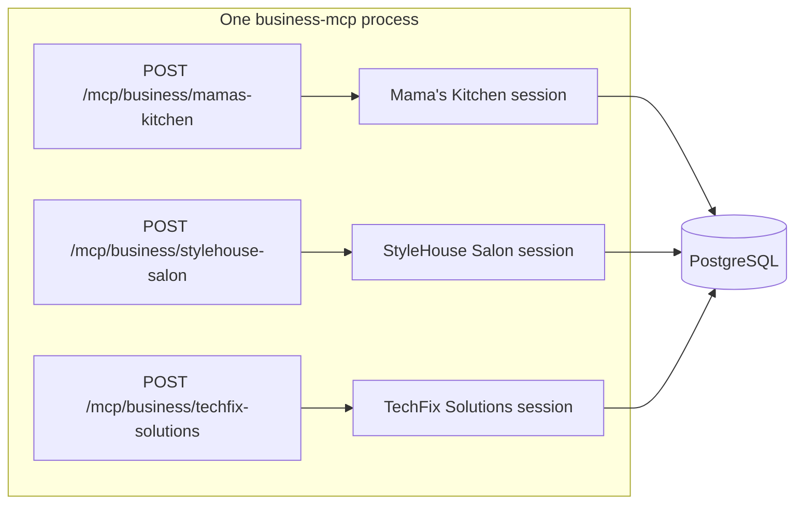
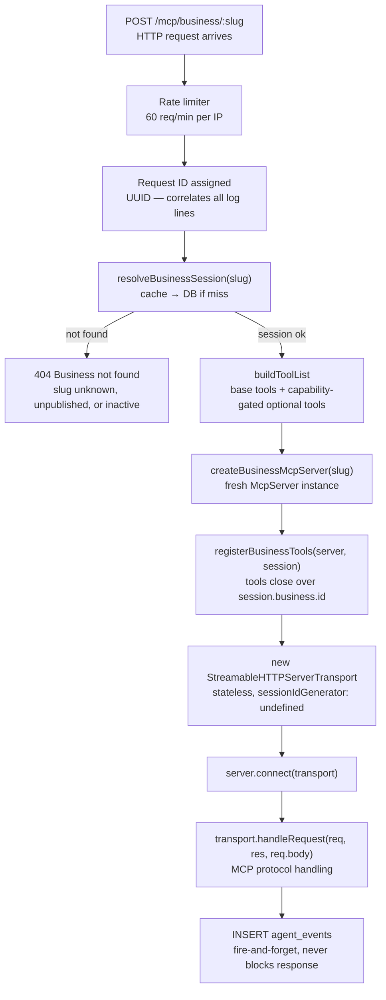
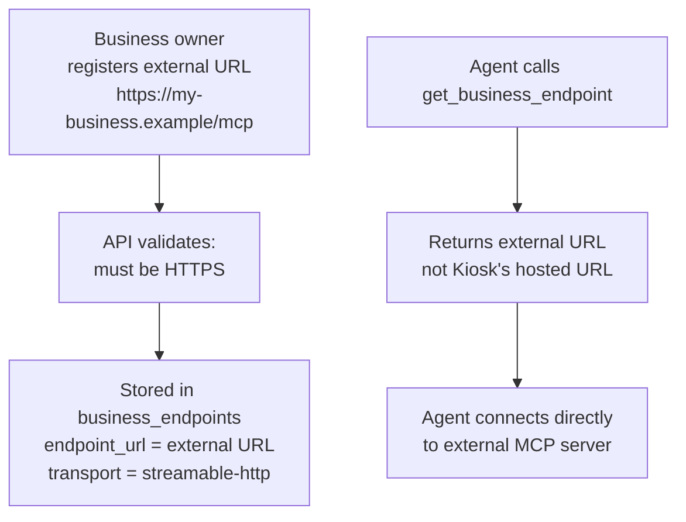

# Kiosk — Business MCP Runtime

The Business MCP runtime is one of the most important architectural decisions in Kiosk. This document explains why it was built the way it was and how it works.

---

## The Problem It Solves

A naive implementation would spawn one Node.js process per business. This does not scale. 1,000 businesses would mean 1,000 processes, each consuming RAM, holding a database connection pool, and requiring its own port. At 100 MB per process, that's 100 GB of RAM just for idle tenants.

Kiosk uses a **shared runtime**: one `business-mcp` process handles all tenants simultaneously. Business identity is determined by the URL path, not the process. This is the same model used by multi-tenant SaaS applications — one application server, many tenants.



---

## Per-Request Architecture

Each MCP request goes through this pipeline:



A fresh `McpServer` and `StreamableHTTPServerTransport` are created for each request. This is intentional — stateless operation means no session state leaks between tenants or requests. The expensive part (DB query) is cached; the server creation is lightweight.

---

## Session Resolution and Cache

`resolveBusinessSession(slug)` is the entry point for every request:

```typescript
export async function resolveBusinessSession(slug: string): Promise<BusinessSession> {
  // 1. Check in-memory cache (Map<slug, {session, expiresAt}>)
  const cached = getCached(slug);
  if (cached) return cached;  // no DB round-trip

  // 2. Query DB — slug must be published AND active
  const [business] = await db
    .select()
    .from(businessesTable)
    .where(and(
      eq(businessesTable.slug, slug),
      eq(businessesTable.status, 'published'),
      eq(businessesTable.isActive, true),
    ))
    .limit(1);

  if (!business) throw Object.assign(new Error('Business not found'), { status: 404 });

  // 3. Load enabled capabilities
  const capabilities = await db
    .select()
    .from(businessCapabilitiesTable)
    .where(and(
      eq(businessCapabilitiesTable.businessId, business.id),
      eq(businessCapabilitiesTable.enabled, true),
    ));

  // 4. Build and cache session
  const session = { business, capabilities, enabledCapabilityKeys: capabilities.map(c => c.capability) };
  setCached(slug, session);  // expiresAt = Date.now() + 30_000
  return session;
}
```

**Cache TTL is 30 seconds.** This means:
- A newly published business becomes discoverable within 30 seconds of publishing
- A deactivated business stops responding within 30 seconds
- Under heavy load, a slug that receives many concurrent requests hits the DB only once per 30 seconds

---

## buildToolList — Capability-Aware Tool Registration

```typescript
export const BASE_TOOLS = [
  'get_business_info',
  'get_services',
  'get_hours',
  'get_contact',
  'get_capabilities',
] as const;

export const OPTIONAL_TOOLS = [
  { name: 'get_products',             requiredCapability: 'products' },
  { name: 'get_delivery_information', requiredCapability: 'delivery' },
  { name: 'create_order_request',     requiredCapability: 'ordering' },
  { name: 'request_booking',          requiredCapability: 'booking' },
];

export function buildToolList(enabledCapabilityKeys: string[]): string[] {
  const capSet = new Set(enabledCapabilityKeys);
  const optional = OPTIONAL_TOOLS
    .filter(t => capSet.has(t.requiredCapability))
    .map(t => t.name);
  return [...BASE_TOOLS, ...optional];
}
```

A restaurant with `ordering` and `delivery` capabilities gets 7 tools. A salon with only `booking` and `services` gets 6 tools. An information-only business gets 5 tools. The tool list in `tools/list` is exactly what the agent can call — no capability, no tool.

---

## Tenant Isolation — How It's Enforced

Every tool handler **closes over** `session.business.id`. This is the structural guarantee of tenant isolation.

```typescript
// In registerBaseTools(server, session):
server.tool('get_services', '...', {}, async () => {
  // 'bid' is session.business.id — captured at registration time
  // This closure makes cross-tenant data access structurally impossible
  const rows = await db.select(...)
    .from(businessServicesTable)
    .where(and(
      eq(businessServicesTable.businessId, bid),  // ← always this tenant
      eq(businessServicesTable.available, true),
    ));
  return { content: [{ type: 'text', text: JSON.stringify(rows) }] };
});
```

Even if two requests for different businesses overlap in time, each server instance has its own registered tools, each closing over its own `bid`. There is no shared mutable state between tenants.

**Verified by integration tests:** `integration.test.ts` creates two connected server/client pairs with different sessions and asserts that calling `get_business_info` on server A returns tenant A's data, and server B returns tenant B's data, never mixing.

---

## External MCP Registration

A business can bring its own MCP server instead of using Kiosk's hosted runtime:



Kiosk remains the **discovery layer** — the Master MCP still handles `search_businesses` and returns the external endpoint URL. The business owns its AI interface entirely. Kiosk just makes it discoverable.

---

## Analytics — Non-Blocking Event Recording

Every tool call records an entry in `agent_events`. This is fire-and-forget — it never blocks or errors the tool response:

```typescript
export function recordToolEvent(businessId: string, toolName: string): void {
  db.insert(agentEventsTable).values({
    businessId,
    eventType: 'tool_call',
    toolName,
    metadata: {},
  }).catch(() => { /* non-critical — log silently */ });
}
```

The analytics data feeds the dashboard's 30-day charts, showing business owners how many MCP sessions and tool calls their endpoint has received alongside REST marketplace events.
