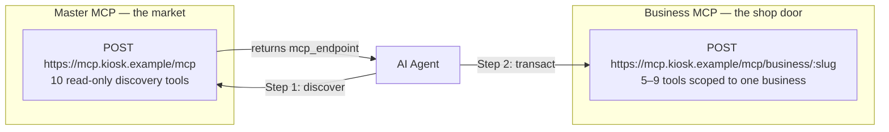
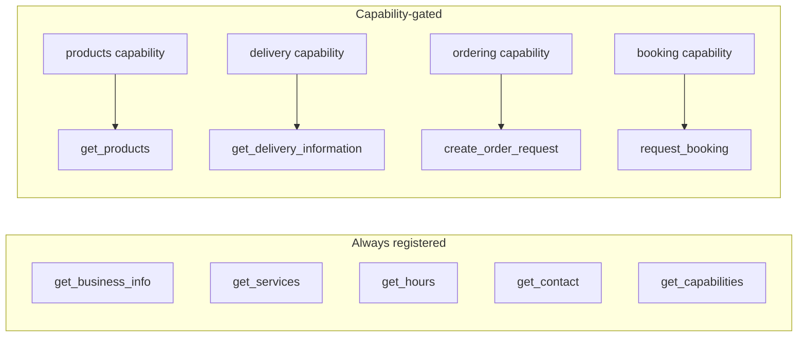

# Kiosk — MCP Implementation Reference

Kiosk implements the [Model Context Protocol](https://modelcontextprotocol.io) at the **2025-11-25** specification level using the official `@modelcontextprotocol/sdk`. Every published business gets a live MCP endpoint automatically — no configuration required from the business owner.

---

## Protocol Details

| Property | Value |
|---|---|
| Protocol version | 2025-11-25 |
| Transport | Streamable HTTP |
| SDK | `@modelcontextprotocol/sdk` v1.32.0 |
| Client compatibility | AWS AgentCore · Amazon Alexa+ · Strands SDK · Claude Desktop · Any MCP client |

---

## Two Endpoints, Two Roles



An agent always starts at the Master MCP to discover businesses, then connects to the specific Business MCP endpoint to execute operations.

---

## Master MCP — Discovery Server

**Endpoint:** `POST https://mcp.kiosk.example/mcp`

All queries filter `status = 'published' AND is_active = true` at the SQL layer. Draft businesses and deactivated businesses are never discoverable.

### Tools

| Tool | Input | Returns | Notes |
|---|---|---|---|
| `discover_categories` | `{}` | `[{id, name, slug, description}]` | Start here — understand what business types exist |
| `search_businesses` | `{query?, city?, country?, category_slug?, open_now?, local_time?, limit?}` | `[{slug, name, city, mcp_endpoint, capabilities[]}]` | Bedrock semantic scoring when enabled |
| `get_business` | `{slug}` | Full public profile | Complete profile including hours, contact |
| `get_business_capabilities` | `{slug}` | `[capability_key]` | Check before connecting to Business MCP |
| `get_business_endpoint` | `{slug}` | `{endpoint_url, transport}` | Final step — get Business MCP URL |
| `check_business_status` | `{slug, iso_time}` | `{is_open, current_day_hours, next_open_at}` | Timezone-aware using business's configured timezone |
| `get_business_contact` | `{slug}` | `{phone, whatsapp, whatsapp_url, website}` | Human fallback — never exposes owner email |
| `get_business_services` | `{slug}` | `[{id, name, description, price, available}]` | Preview services before connecting |
| `get_business_products` | `{slug, category?}` | `[{id, name, description, price, category, available}]` | Preview products before connecting |
| `get_business_delivery` | `{slug}` | `{enabled, configuration}` | Delivery config if capability enabled |

### Full Agent Discovery Flow

```
1. discover_categories {}
   → understand available business types

2. search_businesses { query: "jollof rice", city: "Port Harcourt", open_now: true }
   → [{ slug: "mamas-kitchen-a1b2c3d4", mcp_endpoint: "https://...", capabilities: ["menu","ordering","delivery","contact"] }]

3. check_business_status { slug: "mamas-kitchen-a1b2c3d4" }
   → { is_open: true, current_day_hours: { open: "08:00", close: "22:00" } }

4. get_business_endpoint { slug: "mamas-kitchen-a1b2c3d4" }
   → { endpoint_url: "https://mcp.kiosk.example/mcp/business/mamas-kitchen-a1b2c3d4", transport: "streamable-http" }

5. → Connect to Business MCP at endpoint_url
```

---

## Business MCP — Per-Tenant Runtime

**Endpoint:** `POST https://mcp.kiosk.example/mcp/business/:slug`

Each request resolves the business session, registers tools scoped to that business's enabled capabilities, and handles the MCP request. A fresh MCP server + transport is created per request — the session and tool list are the only state.

### Base Tools (always available)

These five tools are registered for every published business regardless of capabilities.

| Tool | Input | Returns |
|---|---|---|
| `get_business_info` | `{}` | `{name, description, city, country, location, timezone, openingHours, status}` |
| `get_services` | `{}` | `[{id, name, description, price, available}]` |
| `get_hours` | `{}` | `{openingHours, timezone}` |
| `get_contact` | `{}` | `{phone, whatsapp, whatsapp_url, website}` |
| `get_capabilities` | `{}` | `{capabilities: [capability_key]}` |

### Optional Tools (gated by capability)

| Tool | Required Capability | Input | Returns |
|---|---|---|---|
| `get_products` | `products` | `{category?}` | `[{id, name, description, category, price, available}]` |
| `get_delivery_information` | `delivery` | `{}` | `{enabled, configuration: {areas, estimated_time, fee}}` |
| `create_order_request` | `ordering` | `{items[], contact_name, contact_phone, delivery_address?}` | `{order_ref, whatsapp_url, phone, message}` |
| `request_booking` | `booking` | `{service_name, preferred_date, preferred_time, contact_name, contact_phone, notes?}` | `{booking_ref, whatsapp_url, phone, message}` |

### Capability → Tool Mapping



### Transaction Tools — Important Note

`create_order_request` and `request_booking` **do not process payments** and **do not guarantee availability**. They record the intent and return a WhatsApp URL for the business to confirm out-of-band. This is intentional — it keeps Kiosk infrastructure-agnostic and lets businesses use their existing confirmation workflows.

---

## Example — tools/list

```bash
curl -X POST https://mcp.kiosk.example/mcp/business/mamas-kitchen-a1b2c3d4 \
  -H "Content-Type: application/json" \
  -d '{"jsonrpc":"2.0","id":1,"method":"tools/list","params":{}}'
```

```json
{
  "result": {
    "tools": [
      { "name": "get_business_info", "description": "Returns the complete public profile..." },
      { "name": "get_services", "description": "Lists all available services..." },
      { "name": "get_hours", "description": "Returns the opening hours..." },
      { "name": "get_contact", "description": "Returns safe public contact information..." },
      { "name": "get_capabilities", "description": "Lists the MCP capabilities enabled..." },
      { "name": "get_products", "description": "Lists products offered by this business..." },
      { "name": "create_order_request", "description": "Records an order request..." },
      { "name": "request_booking", "description": "Records a booking request..." }
    ]
  }
}
```

## Example — get_contact

```bash
curl -X POST https://mcp.kiosk.example/mcp/business/stylehouse-salon-b2c3d4e5 \
  -H "Content-Type: application/json" \
  -d '{"jsonrpc":"2.0","id":2,"method":"tools/call","params":{"name":"get_contact","arguments":{}}}'
```

```json
{
  "result": {
    "content": [{
      "type": "text",
      "text": "{\"phone\":\"+2348012345678\",\"whatsapp\":\"2348012345678\",\"whatsapp_url\":\"https://wa.me/2348012345678\",\"website\":\"https://stylehouseph.ng\"}"
    }]
  }
}
```

## Example — create_order_request

```bash
curl -X POST https://mcp.kiosk.example/mcp/business/mamas-kitchen-a1b2c3d4 \
  -H "Content-Type: application/json" \
  -d '{
    "jsonrpc": "2.0",
    "id": 3,
    "method": "tools/call",
    "params": {
      "name": "create_order_request",
      "arguments": {
        "items": [
          { "product_name": "Jollof Rice", "quantity": 2 },
          { "product_name": "Chicken", "quantity": 1 }
        ],
        "contact_name": "Ada Okafor",
        "contact_phone": "+2348099999999",
        "delivery_address": "14 Aba Road, Port Harcourt"
      }
    }
  }'
```

```json
{
  "result": {
    "content": [{
      "type": "text",
      "text": "{\"order_ref\":\"ORD-1749260583\",\"message\":\"Order request recorded. Contact the business to confirm and pay.\",\"whatsapp_url\":\"https://wa.me/2348012345678\",\"phone\":\"+2348012345678\",\"instructions\":\"Contact the business directly to confirm your order and arrange payment.\"}"
    }]
  }
}
```

---

## Error Codes

| Code | Meaning | When it occurs |
|---|---|---|
| `-32001` | Business not found, unpublished, or inactive | Slug doesn't exist, or `is_active = false`, or `status != published` |
| `-32002` | Capability not enabled | Tool called but its capability is not in the business's enabled set |
| `-32602` | Invalid tool input | JSON Schema validation failure on tool arguments |

---

## Security Properties

- `ownerClerkId` is never selected in any public MCP query — excluded at the SQL column list level
- Only `status = 'published' AND is_active = true` businesses are reachable — enforced at SQL layer in both session resolution and discovery queries
- A deactivated business stops serving within 30 seconds (one TTL cache cycle)
- Rate limiting: 60 requests/minute per IP on all MCP endpoints
- All tool handlers close over `session.business.id` — cross-tenant data access is structurally impossible

---

## Testing MCP Locally

```bash
# Start business-mcp
cd artifacts/business-mcp && pnpm build && pnpm start

# List tools
curl -s -X POST http://localhost:5001/mcp/business/YOUR_SLUG \
  -H "Content-Type: application/json" \
  -d '{"jsonrpc":"2.0","id":1,"method":"tools/list","params":{}}' \
  | jq '[.result.tools[].name]'

# Call a tool
curl -s -X POST http://localhost:5001/mcp/business/YOUR_SLUG \
  -H "Content-Type: application/json" \
  -d '{"jsonrpc":"2.0","id":2,"method":"tools/call","params":{"name":"get_business_info","arguments":{}}}' \
  | jq '.result.content[0].text | fromjson'
```
