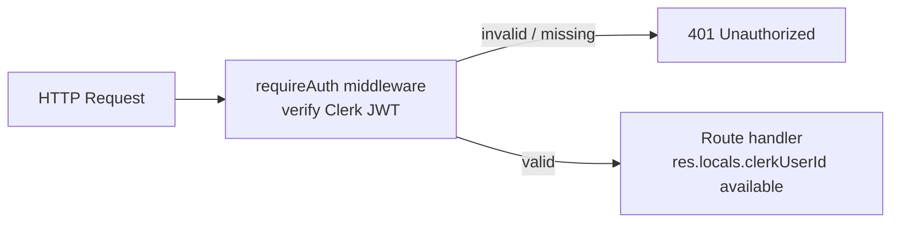

# Kiosk — Security Model

---

## Authentication

All business-owner endpoints require a valid Clerk JWT in the `Authorization: Bearer` header. The `requireAuth` middleware verifies the JWT, extracts `userId`, and sets `res.locals.clerkUserId` before any route handler runs. Unauthenticated requests return HTTP 401.



---

## Owner Isolation

Business owners can only read and modify their own businesses. The `assertOwnership(businessId, ownerId)` function queries:

```sql
SELECT * FROM businesses WHERE id = $1 AND owner_clerk_id = $2
```

If no record is found — whether the business doesn't exist or belongs to a different owner — HTTP 404 is returned, not 403. This prevents information leakage about whether a business ID exists at all.

Every mutating route calls `assertOwnership` before touching the database. The publish endpoint, edit endpoint, and analytics endpoint all go through this check.

---

## MCP Privacy — No Private Data in Responses

MCP tool responses never include:

- `owner_clerk_id` — excluded at the SQL column selection level, not filtered in application code
- Clerk user email or profile data
- Internal system identifiers beyond the public `slug`

This is enforced structurally. The `base.ts` tool handlers only read the fields they explicitly select. Even if a bug introduced incorrect application-layer logic, the underlying SQL would not have retrieved the private fields.

**Verified by tests:** `privacy.test.ts` uses fast-check property testing to assert `ownerClerkId` never appears in any tool response JSON across 1000 random inputs.

---

## Discovery Filtering — SQL Layer

Unpublished and inactive businesses are excluded at the **SQL layer**, not in application code:

```sql
WHERE status = 'published' AND is_active = true
```

This applies in three places:
1. `resolveBusinessSession(slug)` in business-mcp — slug routing
2. Master MCP discovery queries — `search_businesses`, `get_business`, etc.
3. Public marketplace REST API — `GET /api/marketplace`

No application-layer filtering bug can expose a draft business through MCP.

---

## Input Validation

All REST endpoints validate request bodies against Zod schemas before processing. Invalid input returns HTTP 400 with field-level error details.

**Phone validation** — must look like a phone number, rejects URLs:
```typescript
.refine((v) => !v || (!/https?:\/\//i.test(v) && /^[+\d][\d\s().\-]{5,}$/.test(v.trim())))
```

**Website validation** — must be a valid `http://` or `https://` URL:
```typescript
.refine((v) => !v || /^https?:\/\/.+\..+/i.test(v))
```

**WhatsApp normalisation** — stored as digits-only in international format, transformed at write time:
```typescript
.transform((v) => v ? v.replace(/\D/g, '') : v)
```

This means `get_contact` always returns a clean `https://wa.me/2348012345678` URL regardless of how the owner entered the number.

---

## Rate Limiting

In-process token-bucket rate limiter (swap to Redis-backed for multi-instance production):

| Endpoint group | Limit | Window |
|---|---|---|
| Public MCP endpoints | 60 req/min per IP | 1 minute |
| Marketplace REST API | 120 req/min per IP | 1 minute |
| Business write endpoints (POST/PATCH) | 30 req/min per IP | 1 minute |

Rate limit headers returned on every response: `RateLimit-Limit`, `RateLimit-Remaining`, `RateLimit-Reset`. Exceeded limits return HTTP 429 with `Retry-After`.

---

## Secrets Management

All credentials are stored in **AWS Secrets Manager** and injected into ECS tasks by ARN at task launch. No secrets appear as plaintext in:

- Source code
- Task definitions
- CI/CD pipeline logs
- ECS console environment variable display

```json
{
  "secrets": [
    {
      "name": "DATABASE_URL",
      "valueFrom": "arn:aws:secretsmanager:us-east-1:ACCOUNT:secret:kiosk/database-url"
    }
  ]
}
```

---

## Error Handling

The central Express error handler (`errorHandler` middleware) ensures no stack traces or internal details leak in API responses:

| Error type | HTTP status | Response |
|---|---|---|
| Zod validation error | 400 | `{error: "Validation error", details: {fieldErrors}}` |
| Ownership / not found | 404 | `{error: "Business not found"}` |
| PostgreSQL error (SQLSTATE code) | 503 | `{error: "Service temporarily unavailable"}` |
| Anything else | 500 | `{error: "Internal server error"}` |

Full errors are logged server-side via pino with structured JSON. They are never sent to the client.

---

## Request Traceability

The business-mcp generates a UUID `reqId` for every MCP request:

```typescript
app.use((req, _res, next) => {
  (req as Request & { id: string }).id = randomUUID();
  next();
});
```

This ID is:
- Included in all pino log lines for that request
- Passed to the `session_start` agent event in the database
- Returned in error responses for client-side debugging

This means any agent session can be traced from ALB access logs → pino structured logs → agent_events database records.

---

## Known Limitations

| Limitation | Risk | Mitigation path |
|---|---|---|
| Rate limiting is in-process | Bypassed if traffic hits multiple ECS tasks | Switch to Redis-backed `express-rate-limit` |
| No Clerk webhook for user deletion | Orphaned business records if account deleted via Clerk dashboard | Add `user.deleted` webhook handler |
| MCP session cache is in-memory | Cache not shared across ECS tasks | Add Redis for distributed session cache |
| No IP allowlisting on MCP endpoints | Public MCP is accessible to anyone | Add WAF rules via CloudFront if needed |
| External MCP URL validation is HTTPS-only | HTTP SSRF not possible | TLS enforcement already in place |
