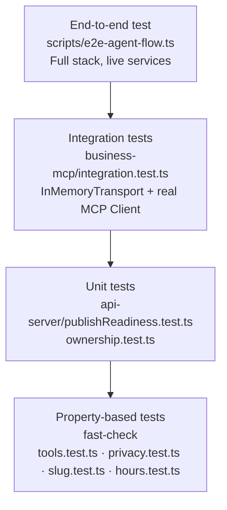

# Kiosk — Test Strategy

---

## Overview

Kiosk uses three testing layers: **property-based tests** for invariants that must hold across all inputs, **unit tests** for specific correctness requirements, and **integration tests** using real connected MCP server/client pairs.



---

## Running All Tests

```bash
# lib/db — 12 tests
cd lib/db && npx vitest run

# api-server — 16 tests
cd artifacts/api-server && npx vitest run

# business-mcp — 21 tests
cd artifacts/business-mcp && npx vitest run

# Typecheck (no errors expected)
cd lib/api-zod            && npx tsc --noEmit
cd artifacts/api-server   && npx tsc --noEmit
cd artifacts/business-mcp && npx tsc --noEmit
cd artifacts/kiosk-frontend && npx tsc --noEmit
```

---

## Test Inventory

### lib/db — 12 tests

**`slug.test.ts`** (5 tests, fast-check property-based)

Proves that `generateSlug(businessName, id)` is well-formed and unique regardless of input.

| Property | What it asserts |
|---|---|
| Slug format invariant | For any non-empty name and UUID, result matches `^[a-z0-9][a-z0-9-]{0,58}[a-z0-9]$` |
| Uniqueness | For any name and two distinct UUIDs, the two slugs are always different |
| Determinism | Same name + same ID always produces the same slug |
| Truncation safety | Very long names truncate cleanly without trailing dashes |
| Fallback | Empty/whitespace-only name produces `"business-{id.slice(0,8)}"` |

**`hours.test.ts`** (7 tests, fast-check property-based)

Proves `isBusinessOpen(business, nowUtc)` is correct across all timezone and hours combinations.

| Property | What it asserts |
|---|---|
| Open boundary | At exactly `open` time: `is_open = true` |
| Pre-open boundary | 1 second before `open` time: `is_open = false` |
| Closed day | Any timestamp on a `closed: true` day: always `is_open = false` |
| Next open scan | When closed, `next_open_at` is within 7 days and is a valid ISO-8601 string |
| Timezone handling | Result is correct for Africa/Lagos, Europe/London, America/New_York |

---

### api-server — 16 tests

**`ownership.test.ts`** (3 tests, fast-check property-based)

Proves the ownership isolation invariant holds for any dataset shape.

| Property | What it asserts |
|---|---|
| Owner isolation | For any mixed-owner dataset, `filterByOwner(userId)` returns only businesses where `ownerClerkId === userId` |
| Cross-owner returns undefined | `findOwned(id, wrongOwner)` always returns undefined |
| Correct owner returns business | `findOwned(id, correctOwner)` always returns the business |

**`publishReadiness.test.ts`** (13 tests)

Covers every combination of blocking and recommended field states.

| Test | What it asserts |
|---|---|
| All fields present | `ready: true`, `blocking: []` |
| Missing businessName | `blocking` contains `'businessName'` |
| Missing location + city + country | `blocking` contains `'location'` |
| Location string present only | `blocking` does NOT contain `'location'` |
| City + country present only | `blocking` does NOT contain `'location'` |
| No contact method at all | `blocking` contains `'contact'` |
| Website only | `blocking` does NOT contain `'contact'` |
| WhatsApp only | `blocking` does NOT contain `'contact'` |
| Missing categoryId | `blocking` contains `'categoryId'` |
| Missing description | `recommended` contains `'description'` |
| Missing openingHours | `recommended` contains `'openingHours'` |
| City already set | `recommended` does NOT contain `'city'` |
| All blocking fields absent | All four blocking fields reported simultaneously |

---

### business-mcp — 21 tests

**`tools.test.ts`** (5 tests, fast-check property-based)

Proves `buildToolList(capabilities)` is correct for any combination of enabled capabilities.

| Property | What it asserts |
|---|---|
| Base tools always present | For any capability set, all 5 base tools always appear |
| Optional tool iff capability enabled | A tool appears if and only if its required capability is in the enabled set |
| No duplicates | `new Set(tools).size === tools.length` for any input |
| Empty capabilities = base tools only | `buildToolList([]).length === BASE_TOOLS.length` |
| All capabilities = all tools | All 9 tools present when all 8 capabilities enabled |

**`privacy.test.ts`** (2 tests, fast-check property-based, 1000 runs)

Proves private data never appears in MCP responses.

| Property | What it asserts |
|---|---|
| ownerClerkId never leaks | JSON of shaped public profile never contains the clerk ID string |
| Shaped profile fields | Expected public fields present, `ownerClerkId` and `id` absent |

**`integration.test.ts`** (14 tests, real connected MCP pairs)

Uses `InMemoryTransport` and `Client` from the official MCP SDK to create real connected server/client pairs. No mocks for the protocol layer.

| Suite | Tests | What it asserts |
|---|---|---|
| tools/list completeness | 4 | `listTools()` returns the right set for a given capability configuration |
| get_business_info | 2 | Correct tenant name returned, ownerClerkId absent |
| get_contact field mapping | 5 | Phone/website/whatsapp in correct fields, REGRESSION: website never in phone field, whatsapp_url built correctly |
| Tenant isolation | 3 | Two servers return different business data, cross-tenant data never appears |

---

## The Regression Test — Website in Phone Field

This is the bug that prompted the validation work. A business that entered their website URL into the phone field would have that URL returned by `get_contact` as the `phone` value — confusing every AI agent that tried to call the business.

The fix is in `lib/api-zod/src/schemas.ts`:

```typescript
phone: z.string().refine(
  (v) => !v || (!/https?:\/\//i.test(v) && /^[+\d][\d\s().\-]{5,}$/.test(v.trim())),
  { message: 'Phone must be a valid phone number, not a URL' }
)
```

The regression test in `integration.test.ts` proves this is caught at the tool output level too:

```typescript
it('REGRESSION: website URL must NOT appear in the phone field', async () => {
  const { client } = await makeConnectedPair(makeSession({
    phone: '+2348099999999',
    website: 'https://should-not-be-in-phone.example',
  }));
  const result = await client.callTool({ name: 'get_contact', arguments: {} });
  const data = JSON.parse(result.content[0].text);
  expect(data.phone).not.toMatch(/^https?:\/\//);  // phone must not be a URL
  expect(data.website).toBe('https://should-not-be-in-phone.example');  // website in correct field
});
```

---

## End-to-End Test

The E2E script (`scripts/e2e-agent-flow.ts`) validates the full stack with live services:

```
1. Connect to Master MCP
2. discover_categories → assert ≥ 1 category
3. search_businesses { query: "jollof rice", city: "Port Harcourt" } → assert Mama's Kitchen found
4. get_business_endpoint { slug } → assert { endpoint_url, transport: "streamable-http" }
5. Connect to Business MCP at endpoint_url
6. get_capabilities → assert "ordering" and "delivery" present
7. get_products → assert ≥ 1 product
8. create_order_request → assert order_ref and whatsapp_url returned
9. Deactivate Mama's Kitchen → search_businesses again → assert NOT in results
```

```bash
# Requires all services running
pnpm e2e
```
